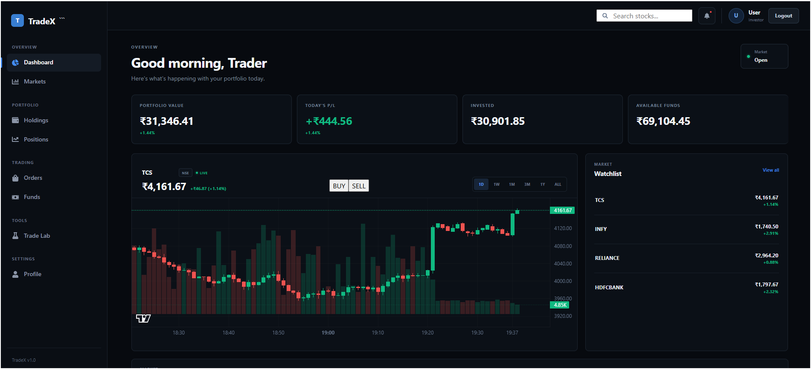
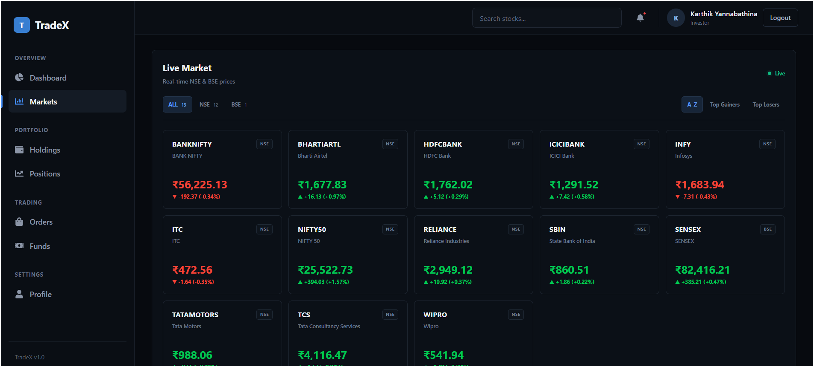
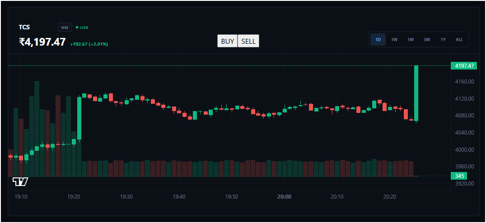
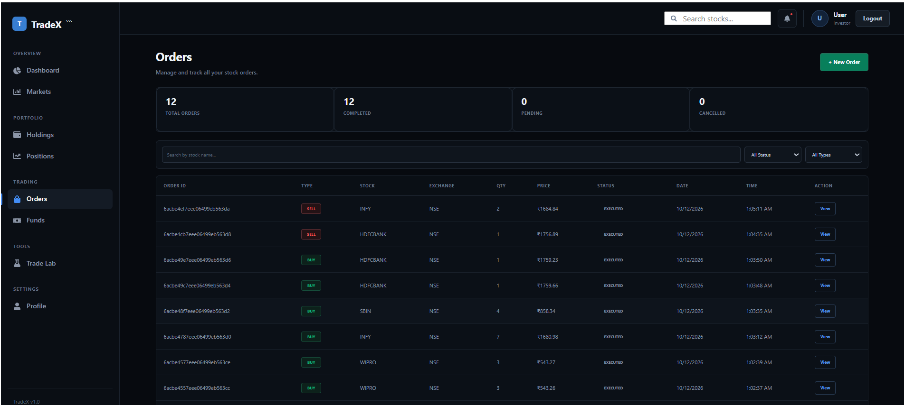
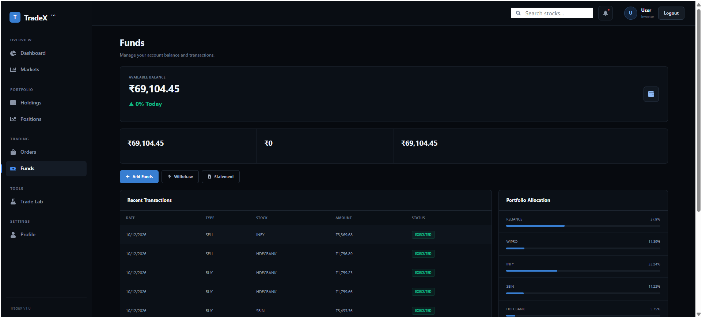
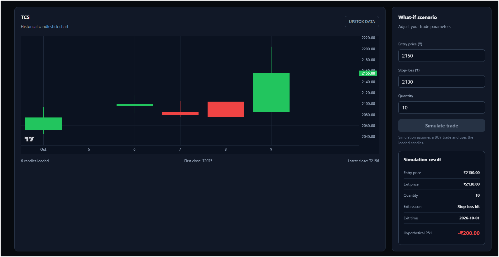

# 📈 TradeX

> A full-stack trading platform built on the MERN stack, with real-time market data, secure order execution, and a modular backend.

[](https://trade-x-gold.vercel.app)


**🔗 Live Demo:** [trade-x-gold.vercel.app](https://trade-x-gold.vercel.app)
**⚙️ API:** [tradex-1-dwyu.onrender.com](https://tradex-1-dwyu.onrender.com)

> ⏳ The backend runs on Render's free tier. If it has been idle, the first request can take ~30–60 seconds to wake up. Please give it a moment.

TradeX is inspired by platforms like Zerodha. It focuses on the **engineering behind a trading system** (auth, order execution, transactions, caching, real-time updates), not just the UI.

> ⚠️ **Disclaimer:** TradeX is an educational portfolio project. Live prices are **simulated**, Trade Lab uses historical candle data, and there is no brokerage connection, no real money and no financial advice.

---

## 📸 Screenshots

### Dashboard
Portfolio value, today's P&L, live candlestick chart with BUY / SELL, and a watchlist.



### Live Market & Charts

| Live Market (NSE + BSE) | Candlestick Chart |
|---|---|
|  |  |

### Orders & Funds

| Order History | Funds & Portfolio Allocation |
|---|---|
|  |  |

### Trade Lab
What-if simulator: set entry, stop-loss and quantity, then see the hypothetical P&L on historical candles.



---

## ✨ Features

**Trading**
- Stock search and live NSE / BSE market page (indices and stocks, sort by Top Gainers / Top Losers)
- Live price updates over WebSockets
- Interactive candlestick charts with volume and timeframes (1D, 1W, 1M, 3M, 1Y, ALL)
- Market BUY / SELL orders with validation
- Order history with search and status / type filters

**Trade Lab**
- What-if trade simulator: choose entry price, stop-loss and quantity
- Runs the trade against historical candles (Upstox data) and shows exit reason and hypothetical P&L

**Portfolio**
- Holdings and positions
- Funds page with available balance, recent transactions and portfolio allocation
- Portfolio value and Profit & Loss tracking
- Performance snapshots over time

**Authentication & Security**
- Register / login with JWT access + refresh tokens (refresh token rotation)
- Protected routes with role-based access control
- Rate limiting, request validation, centralized error handling
- Request IDs and structured request logging

**Backend**
- RESTful API with modular architecture
- MongoDB persistence with transactions for order execution
- Redis caching for market state
- Swagger / OpenAPI documentation

---

## 🏗️ Architecture

```
                    ┌─────────────────┐
                    │    React UI     │
                    └───────┬─────────┘
                            │
              ┌─────────────┴─────────────┐
           REST API                   WebSocket
              │                           │
              ▼                           ▼
     ┌──────────────────────────────────────────┐
     │          Node.js / Express API           │
     │  Auth · Orders · Portfolio · Market Data │
     └───────────────┬──────────────────────────┘
                     │
         ┌───────────┼───────────┐
         ▼           ▼           ▼
      MongoDB      Redis     Socket.IO
   (persistent)  (market     (live price
                  cache)      broadcast)
```

**Backend layering:**

```
Route → Middleware (auth, validation, rate limit, logging)
      → Controller → Service → Data layer → MongoDB / Redis
```

### Order execution flow

```
POST /orders
   │
   ├─ Authenticate user
   ├─ Validate request body
   ├─ Validate stock + read current market price
   ├─ Check funds (BUY) / holdings (SELL)
   │
   ▼
MongoDB transaction ── updates together ──►  Account · Holdings · Order · Performance snapshot
```

Everything related to one order is committed together, so the account, holdings and order history never go out of sync.

---

## 🛠️ Tech Stack

| Layer | Technologies |
|---|---|
| **Frontend** | React, Vite, JavaScript, Axios, Socket.IO Client, Lightweight Charts |
| **Backend** | Node.js, Express, Mongoose, JWT, Socket.IO, Swagger/OpenAPI |
| **Data** | MongoDB (Atlas), Redis (Upstash) |
| **DevOps / Tools** | Docker, Git, GitHub, Postman, Vercel, Render |

---

## 🧠 Engineering Notes

Real problems I hit and fixed while building TradeX:

| Problem | Fix |
|---|---|
| Order controller trusted `req.body.user`, so a client could place orders as another user | User identity now comes only from the verified JWT, never from the request body |
| `.gitignore` was missing, so env files and credentials ended up in git history | Added `.gitignore`, stopped tracking secrets, moved config to environment variables |
| `dotenv@17` injected output into stdout and broke the app's output | Pinned to `dotenv@16` |
| `mongoose@9.8.0` rejected callback-style hooks | Updated the model hooks to the supported style |
| Empty route stubs crashed Express on startup | Removed or implemented the stubs |

---

## 📁 Project Structure

```
TradeX/
├── frontend/
│   └── src/
│       ├── components/   # Dashboard, Navbar, Sidebar, StockSearch
│       ├── context/
│       ├── layouts/
│       ├── pages/
│       ├── services/     # API calls
│       ├── utils/
│       └── socket.js     # Socket.IO client
│
├── backend/
│   └── src/
│       ├── config/
│       ├── constants/
│       ├── docs/         # Swagger / OpenAPI
│       ├── errors/       # custom error classes
│       ├── events/
│       ├── jobs/
│       ├── middlewares/
│       ├── modules/      # feature modules (auth, orders, portfolio, market)
│       ├── app.js
│       └── server.js
│
├── .gitignore
└── README.md
```

---

## 🚀 Getting Started

### Prerequisites
Node.js (18+), npm, MongoDB (local or Atlas), Redis (Docker recommended), Git.

### 1. Clone

```bash
git clone https://github.com/karthikyannabathina/TradeX.git
cd TradeX
```

### 2. Install dependencies

```bash
cd backend && npm install
cd ../frontend && npm install
```

### 3. Environment variables

Create `backend/.env`:

```env
PORT=5000
MONGO_URI=your_mongodb_connection_string
REDIS_URL=redis://localhost:6379
JWT_ACCESS_SECRET=change_me
JWT_REFRESH_SECRET=change_me_too
CLIENT_URL=http://localhost:5173
```

Create `frontend/.env`:

```env
VITE_API_URL=http://localhost:5000
```

> Never commit `.env` files or secrets.

### 4. Start Redis (Docker)

```bash
docker run -d --name tradex-redis -p 6379:6379 redis
```

### 5. Run the app

```bash
# Terminal 1: backend
cd backend && npm run dev

# Terminal 2: frontend
cd frontend && npm run dev
```

Frontend: `http://localhost:5173`

---

## 📚 API Documentation

Interactive Swagger docs are available on the running backend. Example endpoints:

| Method | Endpoint | Description |
|---|---|---|
| POST | `/auth/register` | Create an account |
| POST | `/auth/login` | Login, receive access + refresh tokens |
| POST | `/auth/refresh` | Get a new access token |
| POST | `/orders` | Place a BUY / SELL order 🔒 |
| GET | `/orders` | Order history 🔒 |
| GET | `/portfolio` | Holdings and P&L 🔒 |

🔒 = requires a valid access token. *(Adjust paths to match your actual routes.)*

---

## 🌐 Deployment

| Service | Platform |
|---|---|
| Frontend | Vercel |
| Backend | Render |
| Database | MongoDB Atlas |
| Cache | Upstash Redis |

---

## 🗺️ Roadmap

**Done**
- [x] Auth with JWT access + refresh tokens
- [x] Real-time market updates and candlestick charts
- [x] Stock search, watchlist, holdings
- [x] Order execution with MongoDB transactions
- [x] Portfolio performance tracking
- [x] Frontend + backend deployment

**Next**
- [ ] Automated unit and integration tests
- [ ] CI/CD pipeline
- [ ] Advanced portfolio analytics
- [ ] More order types
- [ ] Monitoring and observability

---

## 👨‍💻 Author

**Karthik Yannabathina**
Full Stack Developer (MERN), final-year B.Tech CSE student.

- GitHub: [@karthikyannabathina](https://github.com/karthikyannabathina)
- LinkedIn: [add your LinkedIn URL here](https://www.linkedin.com/in/your-profile)
- Email: your-email@example.com

⭐ If you found TradeX interesting, consider starring the repo.
